# CodexHost · H.D.D + Fairy（`manifestVersion: 2` · v2.2.0）

为 **CodexHost（Codex Desktop & CH Web）** 打造的《绝区零》风格统一 Host 扩展（`manifestVersion: 2`），全面适配 **CodexHost v0.28.1**：

- **三套绝区零风格预设 · 自动明暗联动**：
  - **方案 A · H.D.D 黑金重工（`amber`）**：碳纤维深黑底座、琥珀金高亮与斜切角工业边框（自动深色模式）；
  - **方案 B · 新艾利都街头 HUD（`street`）**：赛博酸橙绿高对比街头 HUD 与警戒线装饰（自动深色模式）；
  - **方案 C · 绳网高反差白卡（`archive`）**：绳网档案级高反差浅色界面（自动整页浅色模式），同时为代码块保留护眼黑曜石内胆与暗色终端；
  - **6 大面板独立混搭矩阵**：左侧栏/顶栏、欢迎页与对话流、输入舱与审批问答、右侧工作台、设置与插件中心、新会话算力用量面板均可分别启停或跨预设混搭。
- **Antigravity 元素周期表模型选择器 & 超频胶囊滑轨**：
  - 为 Antigravity 打造 2×2 元素核心矩阵（`01 H` / `06 C` / `10 Ne` / `18 Ar`）+ 扩展模型目录；
  - Codex 风格饱满胶囊思考档位滑轨：纯白圆形滑块、超频档（Overdrive）胶囊内单向高速流光粒子与星尘拖尾，切换档位时面板原地保持不闪闭。
- **12 项绝区零交互动效（Juice）与视口按需动态眼徽**：
  - 机械键帽按压、45° 金属扫光、输入舱聚焦警戒条推进、战术点击瞬闪等 12 项微交互（自动遵循 `prefers-reduced-motion`，支持一键开关）；
  - 连续助手消息采用 Telegram 风格头像归组，仅在当前视口内组尾气泡按需挂载轻量动态 Fairy 眼徽（滚出视口即卸载、窗口隐藏自动暂停眨眼，与 v0.28.1 原生虚拟滚动零冲突）。
- **新会话算力用量终端（`web`）**：
  - 欢迎页顶部集成可折叠算力胶囊条与展开态统计终端（KPI 卡片、26 周算力热力图、模型/Harness 拆解与模型配额），直接读取 CodexHost 原生统计。
- **跨端开机动画、悬浮眼徽与零 Emoji 控制中心（`widget` + `page`）**：
  - Desktop 与 Web 主窗口自动挂载静音 H.D.D 开机动画（`assets/boot.webp`）、全息居中问候与可拖动 Fairy 悬浮眼徽（手机端自动停用）；
  - 全仓 36 枚工业几何单线 SVG 图标零 Emoji 覆盖（`shared/hdd-icons.mjs`）。
- **纯前端 · 零后端 · 无音频**：未声明 `backend`，不启动任何 Node 后台子进程，不播放音频，不修改模型或提示词；停用即干净回收全部样式、节点与 DOM 标记。

基于 [AssassinVIX/fairy-zzz-plugin](https://github.com/AssassinVIX/fairy-zzz-plugin) 适配，Fairy 眼徽与动画参考 [Chengzhibense/Fairy-DSH](https://github.com/Chengzhibense/Fairy-DSH)，顶部栏与排版层次参考 [AbiTssE6/dsh-theme-zzz](https://github.com/AbiTssE6/dsh-theme-zzz)。完整来源与许可见 [致谢与素材来源](./CREDITS.md)。

---

## 三套主题与核心部件预览

### 方案 A · H.D.D 黑金重工（`amber` · 默认深色）

| 活跃对话流 · 元素周期表 & 超频胶囊滑轨 | 欢迎页 · 算力用量终端 & 26 周热力图 |
| :---: | :---: |
| 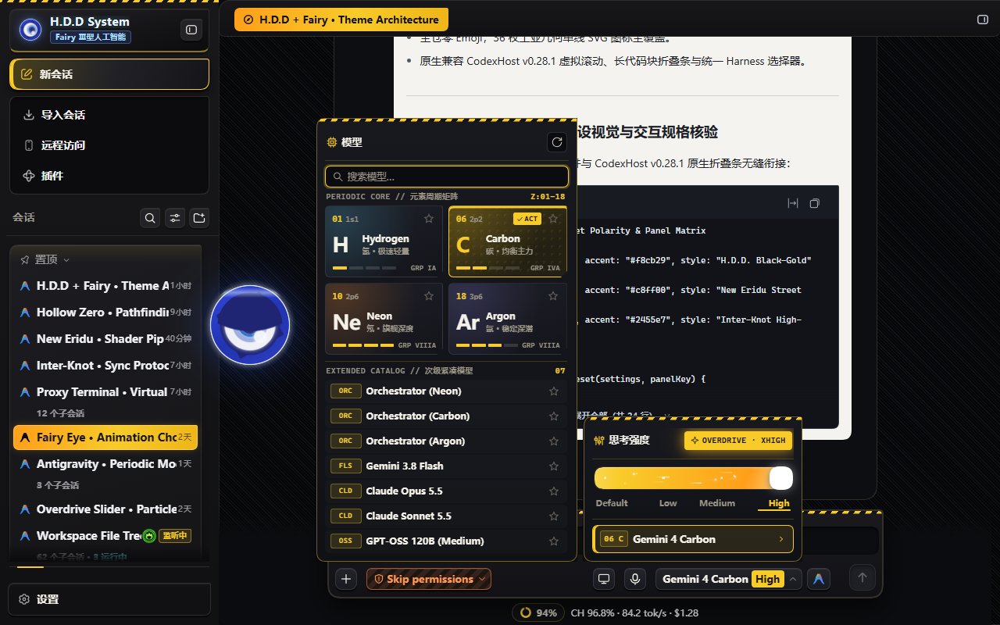 | 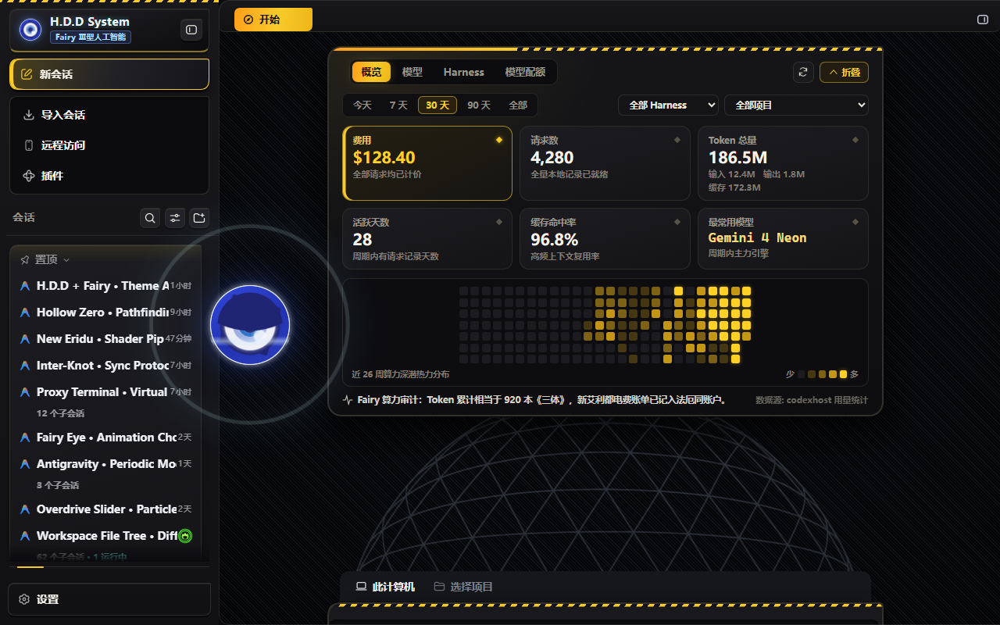 |

| 右侧文件工作台 · 黑曜石代码块 & 统一 Harness 菜单 | H.D.D + Fairy 独立控制页（三预设 & 6 面板矩阵） |
| :---: | :---: |
| 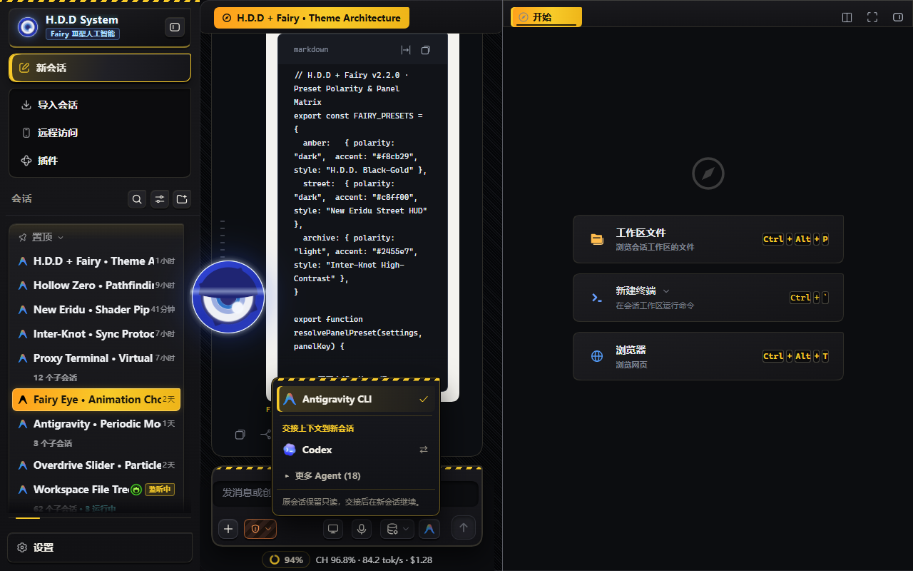 | 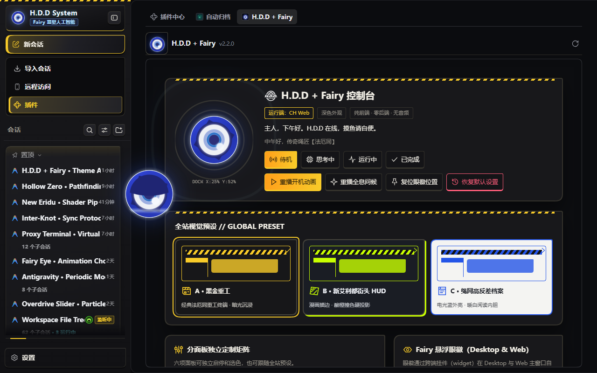 |

| 设置中心 · 远程主机与网络拓扑（v0.28.1） | 移动端 390px 全响应式（抽屉 / 弹性底栏 / 单栏元素周期表） |
| :---: | :---: |
| 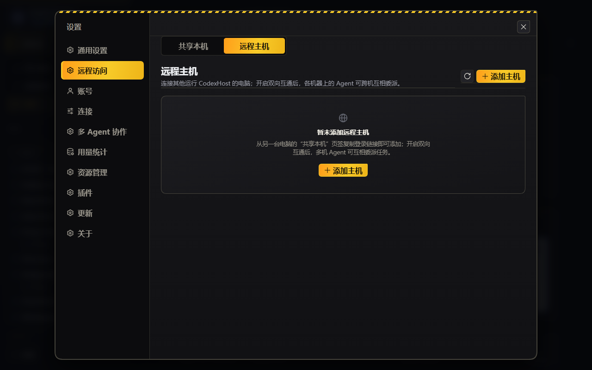 |  |

### 方案 B · 新艾利都街头 HUD（`street` · 酸橙暗色）

| 对话流 · 元素周期表 & 超频滑轨 | 欢迎页 · 算力用量终端 | Fairy 独立控制页 |
| :---: | :---: | :---: |
| 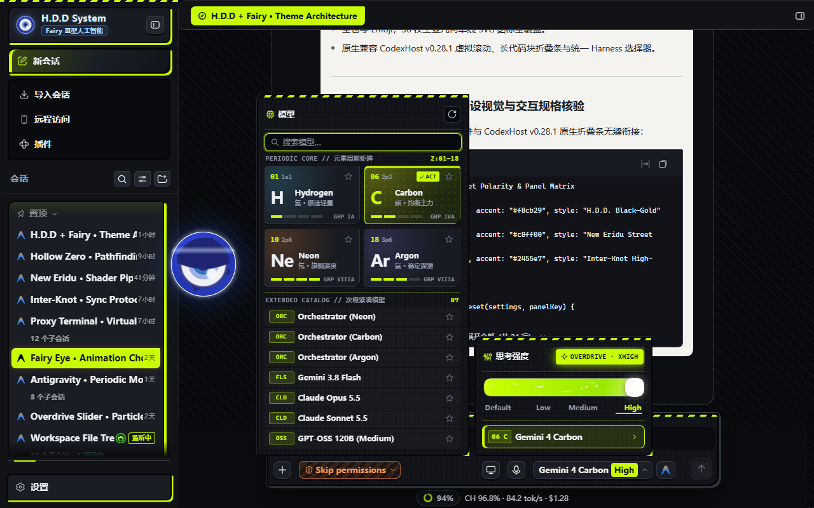 | 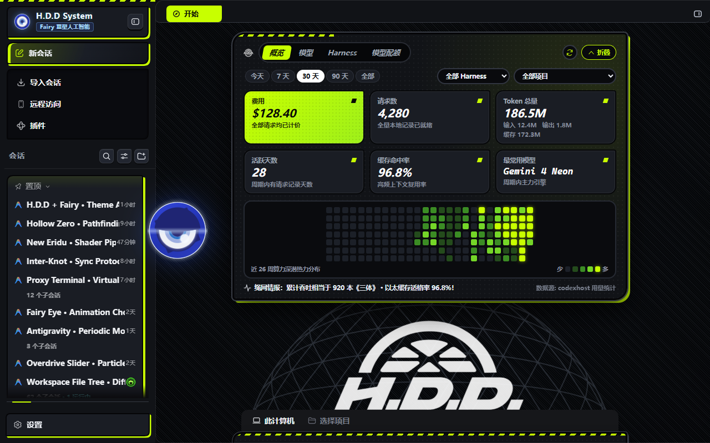 | 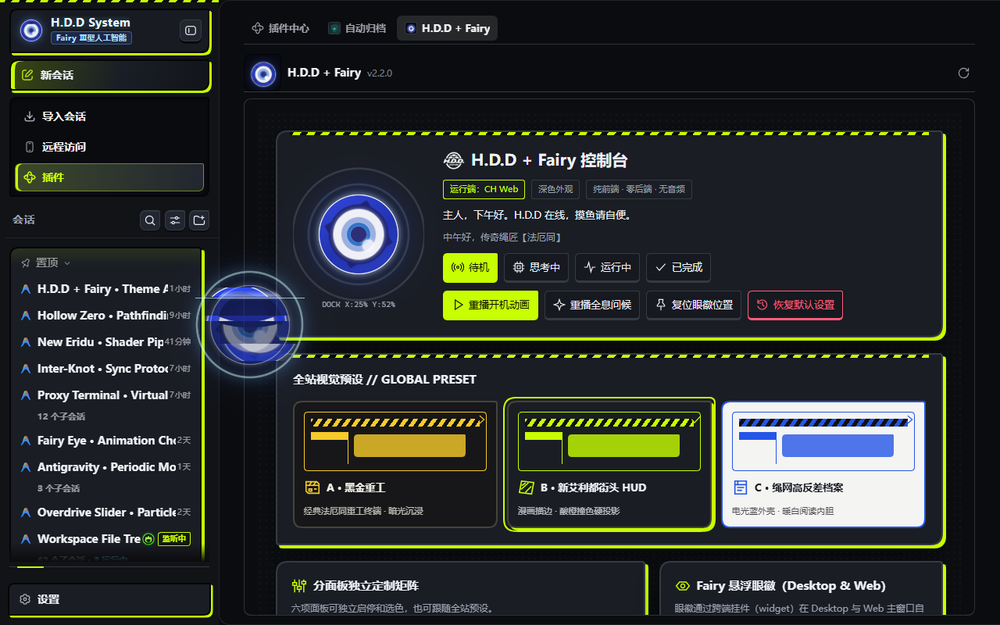 |

### 方案 C · 绳网高反差白卡（`archive` · 自动浅色）

| 对话流 · 自动浅色 & 护眼黑曜石代码块 | 欢迎页 · 算力用量终端 | Fairy 独立控制页 |
| :---: | :---: | :---: |
| 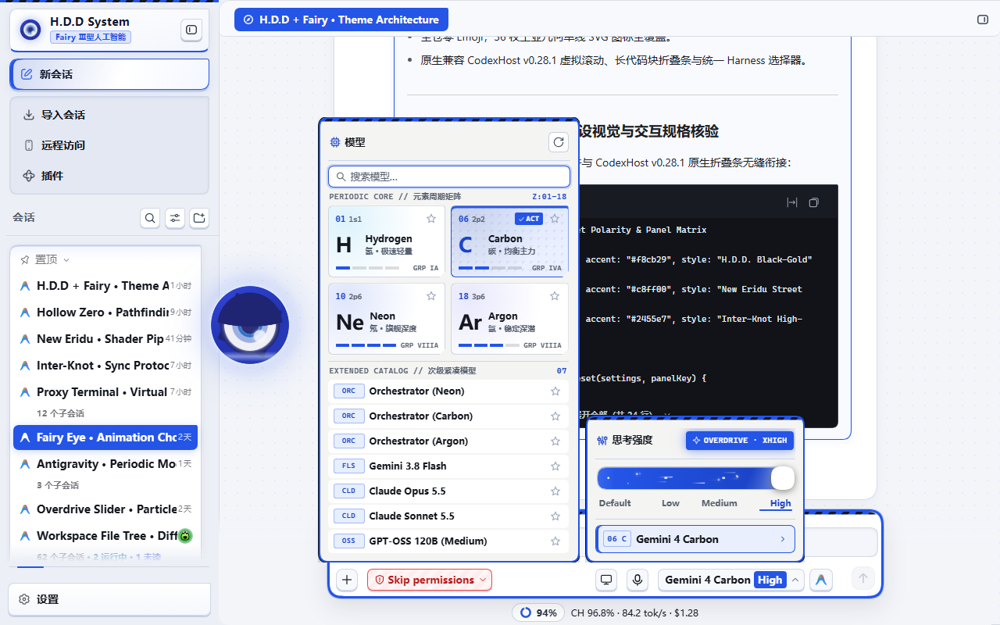 | 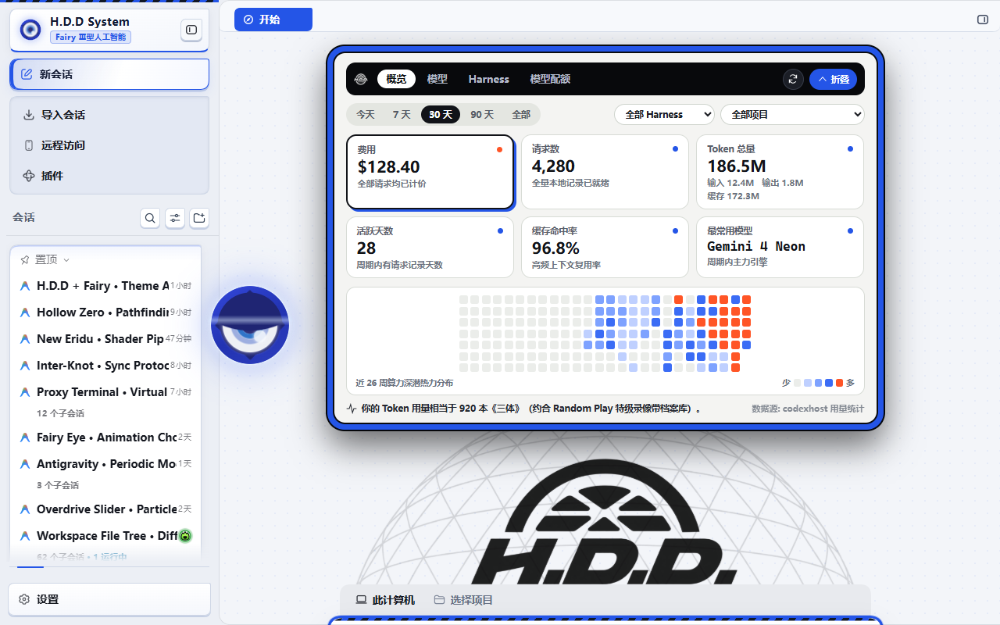 | 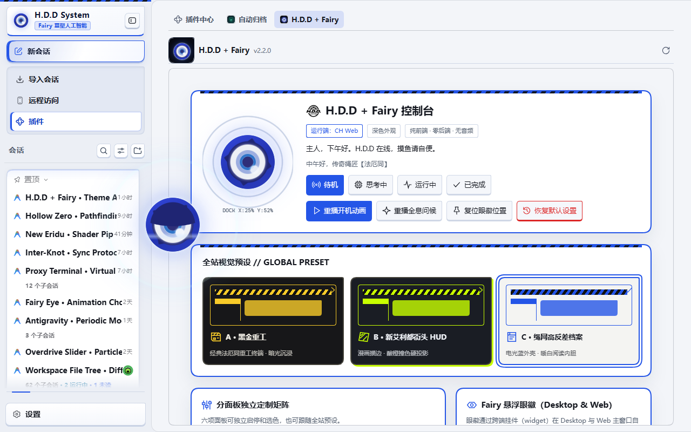 |

---

## 安装与启用

### 方式一：插件市场一键安装 / 更新（推荐）

在 CodexHost 插件市场搜索 **H.D.D + Fairy** 直接安装或更新（发布 GitHub Release 后约 30 分钟内自动同步至插件市场）。

### 方式二：导入 `.zip` 安装包

从 [Releases](https://github.com/biground/codex-host-theme-hdd-fairy/releases) 下载（或在本地运行 `npm run pack` 生成）`hdd-fairy-2.2.0.zip`（`manifest.json` 位于包根）：

- **Codex Desktop**：打开 **设置 → 插件 → 导入插件**，选择 `.zip` 文件导入后打开启用开关。
  - 启用后主窗口自动出现 Fairy 悬浮眼徽；
  - 可在 **设置 → 插件页面 → H.D.D + Fairy** 或插件卡片的「打开页面」进入独立控制台。
- **CH Web**：点击左侧一级导航 **插件** 进入插件中心，导入 `.zip` 文件并打开启用开关。
  - 启用后自动应用 H.D.D + Fairy 全站皮肤、算力用量面板、元素周期表模型选择器与 Fairy 悬浮眼徽；
  - 可直接点击 **「插件」工作区顶部的切页栏**（`H.D.D + Fairy`）切换三套预设、独立配置 6 大面板开关与重播开机动画。

### 方式三：通过 GitHub 仓库地址导入

在 Desktop「设置 → 插件」或 Web「插件 → 插件中心」的导入框中填入公开仓库地址：

```text
https://github.com/biground/codex-host-theme-hdd-fairy
```

仓库根目录已包含符合 CodexHost v2 白名单规范的 `manifest.json` 与全部纯前端静态入口，无需额外构建步骤即可直接导入并启用。

> [!TIP]
> 如需在 Desktop 或 Web 异常时一键还原界面，可在插件管理页面使用「禁用全部扩展」恢复入口。

---

## 插件目录结构

```text
codex-host-theme-hdd-fairy/
├── manifest.json                 # 根级 manifestVersion: 2 清单（双语元数据 + 23 项设置 + page/widget/web）
├── shared/
│   ├── fairy-core.mjs            # 共享默认配置、面板预设解析、眼徽 SVG 动画与多语言问候
│   └── hdd-icons.mjs             # 36 枚全零 Emoji 工业几何单线 SVG 图标库
├── page/
│   ├── index.mjs                 # 跨端独立控制页（三预设卡、6 面板混搭矩阵、动效/眼徽/开机动画开关）
│   └── style.css                 # 继承宿主主题变量 + 三套绝区零风格控制页样式
├── widget/
│   ├── index.mjs                 # 跨端悬浮眼徽挂件与静音 H.D.D 开机演出（Shadow DOM）
│   └── style.css                 # 仅交互元素使用 pointer-events: auto，其余区域完全透传点击
├── web/
│   ├── index.mjs                 # CH Web 宿主主题总控挂载器（极性联动、面板按需注入、算力面板、动效挂载）
│   ├── style.css                 # H.D.D 基底令牌、明暗极性变量桥接与微软雅黑界面排版
│   ├── usage-data.mjs            # CodexHost 原生用量统计与配额聚合适配器
│   ├── usage-panel.mjs           # 欢迎页可折叠算力用量终端（Shadow DOM）
│   ├── usage-panel-css.mjs       # 算力用量终端三预设与移动端响应式样式
│   └── panels/                   # 6 大模块独立样式与动效引擎
│       ├── tokens.mjs            # 三预设色彩、几何切角与阴影语义令牌
│       ├── shell-css.mjs         # 左侧栏、顶栏、滚动条、监听徽章与 390px 抽屉
│       ├── chat-css.mjs          # 对话流、Telegram 头像归组、黑曜石代码块折叠条与命令/压缩卡
│       ├── chat-avatar-fx.mjs    # 视口按需动态 Fairy 眼徽与 v0.28.1 虚拟滚动兼容归组器
│       ├── composer-css.mjs      # 输入舱、队列托盘、审批问答与统一 Harness 菜单
│       ├── model-select-css.mjs  # Antigravity 元素周期表 & Codex 风格超频胶囊滑轨样式
│       ├── model-select-fx.mjs   # 元素周期表矩阵增强、超频粒子流与切档零闪烁交互
│       ├── rightbar-css.mjs      # 右侧工作台、Diff、终端与预览卡样式
│       ├── rightbar-files.mjs    # 右侧文件树轻量搜索过滤与变更标记增强
│       ├── settings-css.mjs      # 设置中心、插件中心、远程主机拓扑与配对弹窗样式
│       ├── settings-shadow.mjs   # 宿主 ShadowRoot 主题变量桥接器
│       ├── juice-css.mjs         # 12 项绝区零机械交互动效 CSS
│       └── juice-fx.mjs          # 战术点击瞬闪与悬停锁定反馈引擎
├── assets/                       # 图标、开机动画（boot.webp）、Fairy 头像与 H.D.D 视觉素材
├── docs/screenshots/v2.2.0/      # v2.2.0 三预设全部件展示截图（市场主图均 ≤ 512 KiB）
├── scripts/pack-zip.mjs          # 零依赖打包脚本，生成 manifest.json 位于包根的 .zip
└── test/                         # 清单、白名单、ZIP、三预设、元素周期表、动效与 v0.28.1 自动化测试
```

---

## 本地开发与打包

```bash
# 语法检查（全部 22 个 ESM 模块）
npm run check

# 运行全部自动化测试（清单、白名单、ZIP 与功能回归）
npm test

# 生成 manifest.json 位于包根的 .zip（默认输出到 ../output/fairy/hdd-fairy-2.2.0.zip）
npm run pack
```

---

## 致谢与许可

- [AssassinVIX/fairy-zzz-plugin](https://github.com/AssassinVIX/fairy-zzz-plugin)：上游 H.D.D 皮肤与 Fairy 交互灵感，保留 [MIT 许可](./LICENSE)。
- [Chengzhibense/Fairy-DSH](https://github.com/Chengzhibense/Fairy-DSH)：Fairy 眼徽 SVG、分层几何与动画参考，保留 [Apache-2.0](./licenses/Apache-2.0.txt) 与 [NOTICE-fairy-dsh.md](./NOTICE-fairy-dsh.md)。
- [AbiTssE6/dsh-theme-zzz](https://github.com/AbiTssE6/dsh-theme-zzz)：顶部栏金色标签与导航线框图标风格参考，保留 [MIT 声明](./licenses/dsh-theme-zzz-MIT.txt)。
- [BytePioneer-AI/codex-host](https://github.com/BytePioneer-AI/codex-host)：提供统一 Host 扩展（`manifestVersion: 2`）运行时与跨端管理能力。

Fairy、《绝区零》、H.D.D 及相关角色形象与商标归 miHoYo / HoYoverse 等原权利人所有。本项目为非官方社区视觉改造扩展，仅供个人非商业使用；代码许可不授予这些素材和商标的权利。
