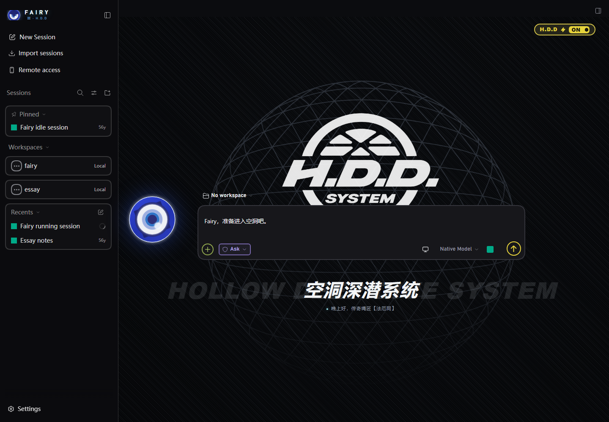
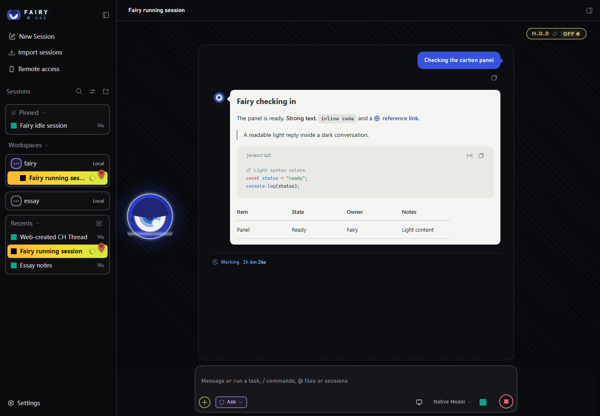
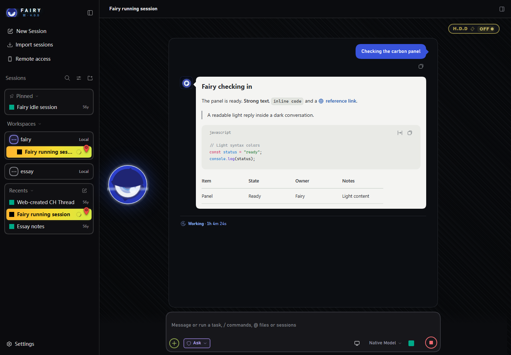
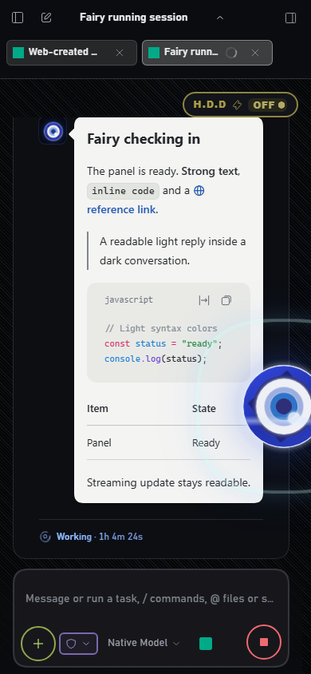

# CodexHost · H.D.D + Fairy

为 **CodexHost Web** 制作的 H.D.D 主题界面扩展：黑色碳纤维面板、蓝白聊天气泡、静音开机动画，以及会随会话状态变化的 Fairy 眼徽。

基于 [AssassinVIX/fairy-zzz-plugin](https://github.com/AssassinVIX/fairy-zzz-plugin) 适配，Fairy 眼徽与动画参考 [Chengzhibense/Fairy-DSH](https://github.com/Chengzhibense/Fairy-DSH)。感谢两位作者的原始实现。完整来源与许可见 [致谢](./CREDITS.md)。

## 直接安装

在 **CodexHost Web → 设置 → 界面扩展 → 添加扩展** 中输入：

```text
https://github.com/biground/codex-host-theme-hdd-fairy
```

点击安装，再打开扩展开关。安装后会播放静音开机动画；必要时刷新页面。

无需手动克隆、构建或安装额外依赖。仓库根目录包含扩展清单、预构建的浏览器模块和静态资源，供 CodexHost 原生扩展管理器安装。

需要固定版本时，输入带 tag 的地址：

```text
https://github.com/biground/codex-host-theme-hdd-fairy#v1.0.3-codexhost.11
```

也可以从 [Releases](https://github.com/biground/codex-host-theme-hdd-fairy/releases) 下载 `.tgz`，在同一个安装框中输入运行 CodexHost 的电脑上的文件绝对路径。

当前版本为 `1.0.3-codexhost.11`，适配验证环境为 **CodexHost Web 0.18.0-beta.5 / Windows / Chromium**。本扩展面向 Web 界面。

已在隔离的真实 CodexHost Web 中，通过「界面扩展」安装框填入公开仓库地址，完成安装、启用、视觉／交互回归与停用清理检查。

<details>
<summary>安装后在界面扩展列表中的显示效果</summary>


</details>

## 预览

以下截图使用合成工作区与测试会话。

新会话：



进行中的会话：



<details>
<summary>查看侧栏与窄屏效果</summary>





</details>

## 包含的效果

- **H.D.D 欢迎页**：透明标志、保持比例的网状球体、「空洞深潜系统」及浅灰英文背景字，按浏览器本地时间显示早上／中午／晚上问候。
- **暗色碳纤维面板**：静态 CSS 斜纹与暗角，侧栏的置顶、各工作区和最近会话独立分框；选中会话显示黄色渐变与红色标记，展开／收起工作区使用不同颜色的圆环图标。
- **聊天气泡**：用户蓝底白字；Agent 白底深色文字、Fairy 图标，正文、引用、代码和表格采用局部浅色配色。继续使用原生流式渲染，宽表格在气泡内横向滚动。
- **输入控件**：绿色加号、紫色权限按钮、可发送时的黄色圈内箭头、不可发送时的红圈叉号、运行中的红圈方块，以及右上角的 `H.D.D ⚡ ON / OFF` 快速模式开关。
- **Fairy 动画**：静音开机、居中问候、可拖动眼徽，以及跟随当前会话的待机／思考／运行／结束状态。点击眼徽查看当前会话状态。
- **原生设置与清理**：在「设置 → Fairy」中调整显示、拖动、位置、外观和重播动画；停用后释放样式、主题 token、插槽、事件监听与资源路由。

音频功能已移除，开机视频没有音轨；不包含 TTS、语音引擎或问候音频。扩展不安装 Agent 人设，不修改模型、提示词或执行逻辑。

## 更新、关闭与恢复

- **更新**：当前 CodexHost 会为扩展保留独立安装副本。卸载旧版，再使用上面的仓库地址安装，获取仓库最新版本；安装固定版本时使用对应 tag。
- **关闭／卸载**：在「设置 → 界面扩展」中操作。若此前安装过本主题的本地适配版，先卸载再安装仓库版本，避免重复的 `dsh-fairy-zzz` 扩展标识。
- **恢复入口**：界面异常时，访问同一 Web 地址下的 `/extensions` 管理扩展，或使用 `/?extensions=off` 临时只加载内置界面。
- **网络要求**：运行 CodexHost Web 服务的电脑需要能访问 GitHub 的归档下载服务。网络受限时可下载 Release 安装包后，通过本地路径安装。

## 开发与验证

浏览器模块已经预构建，修改 `client.js` 后可直接通过本地目录安装。普通使用不需要 `npm install`。

```sh
node --check client.js
npm test
npm pack
```

- `client.js`：外观、动画、原生插槽与会话状态订阅。
- `index.js`：允许列表内的静态资源服务，支持 GET、HEAD 与单段 Range。
- `cordis.patch.yml`、`package.json`：扩展注册与 Web 入口。
- `test/host.test.mjs`：静态资源与路由生命周期回归，无额外依赖。
- `test/web.test.mts`：隔离的真实 Web + 假 Host + Playwright 回归；使用合成消息，不调用真实模型。

Web 回归需要在本仓库旁放置 `codex-host` 源码，并按宿主的开发说明准备其依赖和 Web 构建。目录结构为：

```text
workspace/
  codex-host/
  codex-host-theme-hdd-fairy/
```

在主题仓库中运行：

```powershell
node --import '../codex-host/node_modules/tsx/dist/loader.mjs' --test test/web.test.mts
```

`FAIRY_TEST_WEB_BUNDLE` 可指定已安装发行包的 `app/web-modules/server.mjs`；`FAIRY_TEST_INSTALL_SPEC` 可指定要测试的仓库地址或安装包，省略时测试本地目录。截图写入父目录的 `output/playwright/fairy/`。

验证覆盖安装／启用／停用、无音频、眼徽拖动、浅色恢复、侧栏、输入控件、流式消息和窄屏表格滚动。响应式尺寸检查不等同于手机实机或所有浏览器验证。

## 致谢与许可

- [AssassinVIX/fairy-zzz-plugin](https://github.com/AssassinVIX/fairy-zzz-plugin)：本项目的直接上游，提供 H.D.D 皮肤、开机流程及 Fairy 集成。保留其 [MIT 许可](./LICENSE)。
- [Chengzhibense/Fairy-DSH](https://github.com/Chengzhibense/Fairy-DSH)：Fairy 眼徽 SVG、动画几何与时长、眼睑和眨眼实现的参考来源。保留 [Apache-2.0](./licenses/Apache-2.0.txt)、[NOTICE](./NOTICE-fairy-dsh.md) 和原始署名。
- [BytePioneer-AI/codex-host](https://github.com/BytePioneer-AI/codex-host)：提供 Web 界面扩展、主题、插槽与会话状态接口。

Fairy、《绝区零》、H.D.D 及相关角色形象、开机视频和商标归 miHoYo / HoYoverse 等原权利人所有。本项目是非官方社区适配，沿用上游个人、非商业视觉改造的用途说明；代码许可不授予这些素材和商标的权利。新增背景图的重建方式、固定上游 commit 与文件范围见 [CREDITS.md](./CREDITS.md)。
