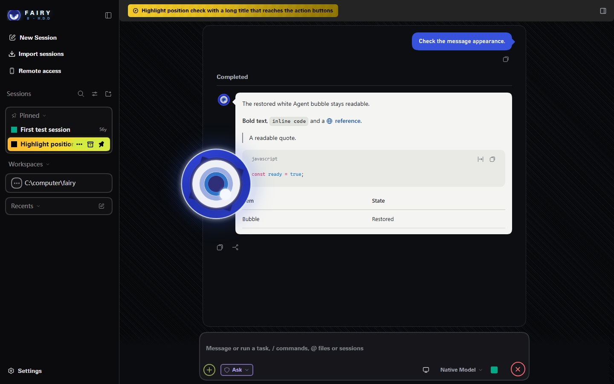

# CodexHost · H.D.D + Fairy（manifestVersion: 2）

为 **CodexHost（Codex Desktop & CH Web）** 打造的统一 Host 扩展（`manifestVersion: 2`）：
- **跨端开机动画与悬浮眼徽挂件（`widget`）**：在 Codex Desktop 与 CH Web 主窗口自动挂载，支持静音 H.D.D 开机动画（`assets/boot.webp` Animated WebP，带跳过与进度条）、全息居中问候、可拖动 Fairy 动态眼徽与状态气泡（手机端自动停用）。
- **跨端独立控制页（`page`）**：在 Desktop「设置 → 插件页面」与 Web「插件」工作区顶部切页栏打开，集中配置眼徽显示、拖拽、尺寸、位置复位、Web 主题开关与实时眼徽状态预览。
- **CH Web H.D.D 碳纤维皮肤（`web`）**：碳纤维暗色背景、蓝白聊天气泡、Fairy 头像、侧栏黄色渐变高亮、黑白高对比问答面板，以及清晰易读的**微软雅黑**界面字体。
- **纯前端 · 零后端 · 无音频**：未声明 `backend`，不启动任何 Node 后台子进程，不播放音频，不修改模型或提示词；停用即干净回收全部样式、节点与 DOM 标记。

基于 [AssassinVIX/fairy-zzz-plugin](https://github.com/AssassinVIX/fairy-zzz-plugin) 适配，Fairy 眼徽与动画参考 [Chengzhibense/Fairy-DSH](https://github.com/Chengzhibense/Fairy-DSH)，顶部栏与排版层次参考 [AbiTssE6/dsh-theme-zzz](https://github.com/AbiTssE6/dsh-theme-zzz)。完整来源与许可见 [致谢与素材来源](./CREDITS.md)。

---

## 安装与启用

### 方式一：导入 `.zip` 安装包（推荐）

从 [Releases](https://github.com/biground/codex-host-theme-hdd-fairy/releases) 下载（或在本地运行 `npm run pack` 生成）`hdd-fairy-2.0.1.zip`（`manifest.json` 位于包根）：

- **Codex Desktop**：打开 **设置 → 插件 → 导入插件**，选择 `.zip` 文件导入后打开启用开关。
  - 启用后主窗口自动出现 Fairy 悬浮眼徽；
  - 可在 **设置 → 插件页面 → H.D.D + Fairy** 或插件卡片的「打开页面」进入独立控制台。
- **CH Web**：点击左侧一级导航 **插件** 进入插件中心，导入 `.zip` 文件并打开启用开关。
  - 启用后主窗口自动出现 Fairy 悬浮眼徽，同时应用 H.D.D 碳纤维皮肤与微软雅黑界面字体；
  - 可直接点击 **「插件」工作区顶部的切页栏**（`H.D.D + Fairy`）打开独立控制页面。

### 方式二：通过 GitHub 仓库地址导入

在 Desktop「设置 → 插件」或 Web「插件 → 插件中心」的导入框中填入公开仓库地址：

```text
https://github.com/biground/codex-host-theme-hdd-fairy
```

仓库根目录已包含符合 CodexHost v2 白名单规范的 `manifest.json` 与全部纯前端静态入口，无需额外构建步骤即可直接导入并启用。

> [!TIP]
> 如需在 Desktop 或 Web 异常时一键还原界面，可在插件管理页面使用「禁用全部扩展」恢复入口。

---

## 预览




---

## 插件目录结构

```text
codex-host-theme-hdd-fairy/
├── manifest.json             # 根级 manifestVersion: 2 清单（双语元数据 + settingsSchema + page/widget/web）
├── shared/
│   └── fairy-core.mjs        # page / widget / web 共享 ESM 模块（眼徽 SVG/动画、默认配置、多语言问候与跨端事件）
├── page/
│   ├── index.mjs             # 跨端独立控制页（导出 mount(root, api)）
│   └── style.css             # 继承 --cx-page-* 宿主主题变量 + 微软雅黑字体
├── widget/
│   ├── index.mjs             # 跨端悬浮眼徽挂件（导出 mount(root, api)，Shadow DOM）
│   └── style.css             # 仅交互元素使用 pointer-events: auto，其余区域完全透传点击
├── web/
│   ├── index.mjs             # CH Web 宿主主题挂载器（导出 activate(api)）
│   └── style.css             # CH Web H.D.D 碳纤维皮肤、聊天气泡、侧栏高亮与微软雅黑字体
├── assets/                   # 图标、Fairy 头像、H.D.D 标志与网状球体等公开静态资源
├── docs/screenshots/         # 插件中心展示截图（单张 ≤ 512 KiB）
├── scripts/pack-zip.mjs      # 零依赖打包脚本，生成 manifest.json 位于包根的 .zip
└── test/extension.test.mjs   # 清单、文件白名单、ZIP 与 CodexHost 校验器自动化测试
```

---

## 本地开发、打包与发布到 GitHub

### 1. 检查、测试与打包 `.zip`

```bash
# 语法检查
npm run check

# 运行清单、白名单与 ZIP 校验测试
npm test

# 生成 manifest.json 位于包根的 .zip（默认输出到 ../output/fairy/hdd-fairy-2.0.1.zip）
npm run pack

# 也可指定自定义输出目录
node scripts/pack-zip.mjs ./dist
```

### 2. 发布到 GitHub

1. 更新 `manifest.json` 与 `package.json` 中的 `version`（例如 `2.0.1`），并运行 `npm run check && npm test && npm run pack` 验证通过；
2. 提交并推送至 `main` 分支：
   ```bash
   git add -A
   git commit -m "feat: migrate H.D.D + Fairy to CodexHost manifestVersion 2"
   git push origin main
   ```
3. 打上版本标签并创建 GitHub Release，将生成的 `hdd-fairy-2.0.1.zip` 与 `icon` / `screenshots` 同名图片上传为 Release 附件：
   ```bash
   git tag v2.0.1
   git push origin v2.0.1
   ```
   （也可使用 `gh release create v2.0.1 ../output/fairy/hdd-fairy-2.0.1.zip assets/icon-180.png docs/screenshots/conversation-current.png docs/screenshots/question-panel-current.png docs/screenshots/sidebar-current.png --title "v2.0.1" --notes "CodexHost manifestVersion 2 unified extension"` 一键发布。）

---

## 致谢与许可

- [AssassinVIX/fairy-zzz-plugin](https://github.com/AssassinVIX/fairy-zzz-plugin)：上游 H.D.D 皮肤与 Fairy 交互灵感，保留 [MIT 许可](./LICENSE)。
- [Chengzhibense/Fairy-DSH](https://github.com/Chengzhibense/Fairy-DSH)：Fairy 眼徽 SVG、分层几何与动画参考，保留 [Apache-2.0](./licenses/Apache-2.0.txt) 与 [NOTICE-fairy-dsh.md](./NOTICE-fairy-dsh.md)。
- [AbiTssE6/dsh-theme-zzz](https://github.com/AbiTssE6/dsh-theme-zzz)：顶部栏金色标签与导航线框图标风格参考，保留 [MIT 声明](./licenses/dsh-theme-zzz-MIT.txt)。
- [BytePioneer-AI/codex-host](https://github.com/BytePioneer-AI/codex-host)：提供统一 Host 扩展（`manifestVersion: 2`）运行时与跨端管理能力。

Fairy、《绝区零》、H.D.D 及相关角色形象与商标归 miHoYo / HoYoverse 等原权利人所有。本项目为非官方社区视觉改造扩展，仅供个人非商业使用；代码许可不授予这些素材和商标的权利。
