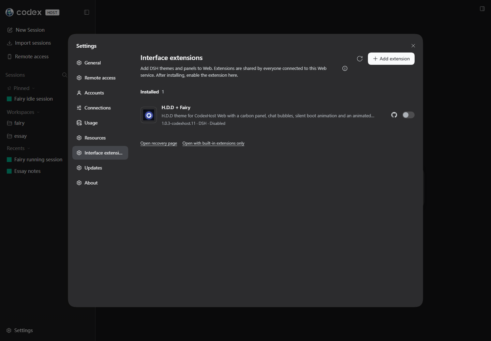
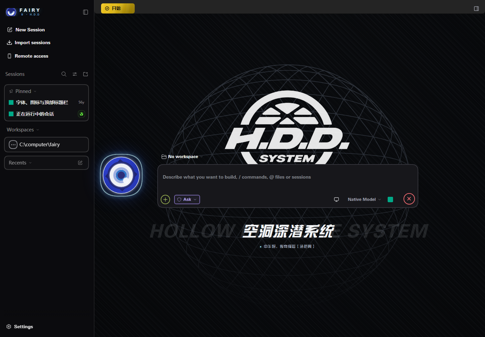
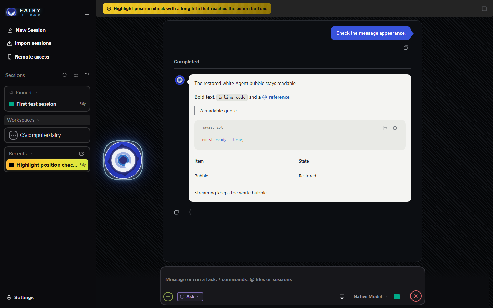
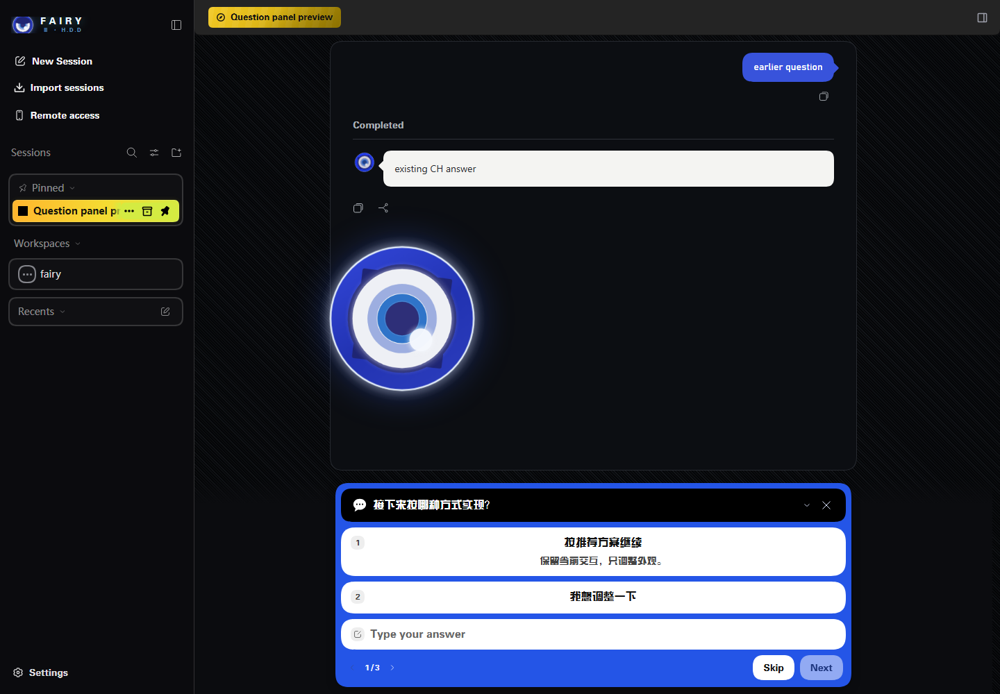
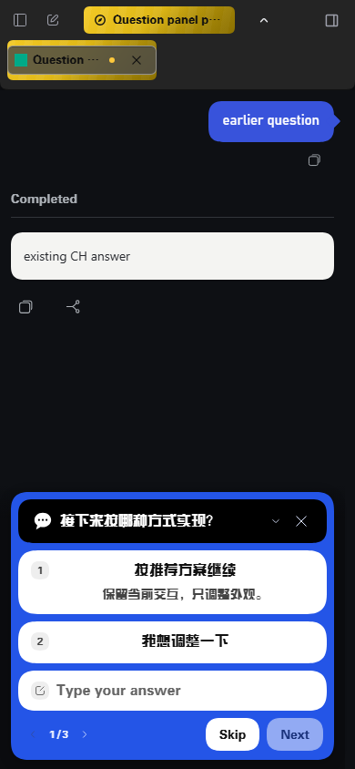
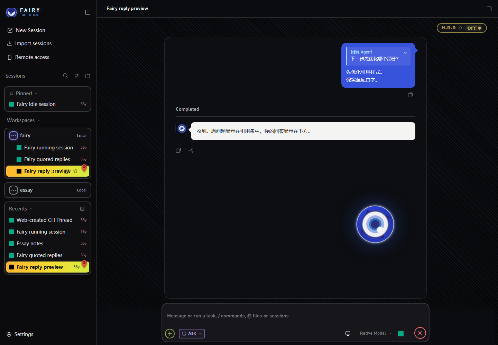
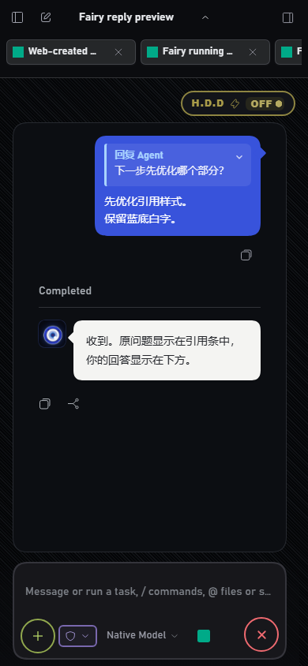
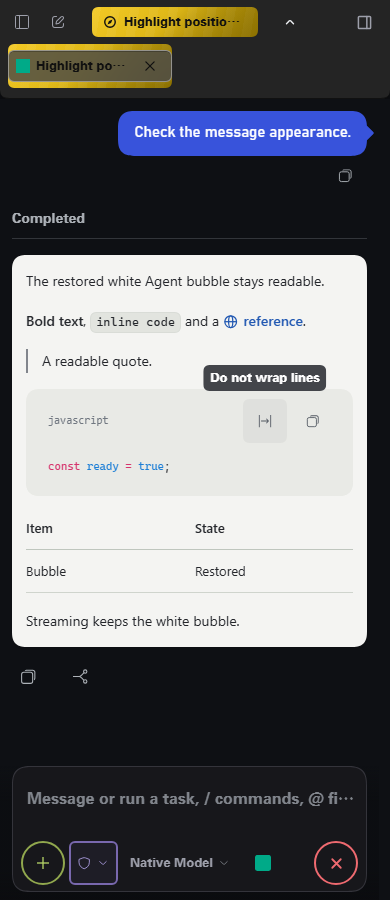

# CodexHost · H.D.D + Fairy

为 **CodexHost Web** 制作的 H.D.D 主题界面扩展：黑色碳纤维面板、蓝白聊天气泡、静音开机动画，以及会随会话状态变化的 Fairy 眼徽。

基于 [AssassinVIX/fairy-zzz-plugin](https://github.com/AssassinVIX/fairy-zzz-plugin) 适配，Fairy 眼徽与动画参考 [Chengzhibense/Fairy-DSH](https://github.com/Chengzhibense/Fairy-DSH)。感谢两位作者的原始实现。完整来源与许可见 [致谢](./CREDITS.md)。

## 直接安装

在 **CodexHost Web → 设置 → 界面扩展 → 添加扩展** 中输入：

```text
https://github.com/biground/codex-host-theme-hdd-fairy
```

点击安装，再打开扩展开关。电脑端会播放静音开机动画；手机端直接进入界面，自动停用开机动画和悬浮眼徽。必要时刷新页面。

无需手动克隆、构建或安装额外依赖。仓库根目录包含扩展清单、预构建的浏览器模块和静态资源，供 CodexHost 原生扩展管理器安装。

需要固定版本时，输入带 tag 的地址：

```text
https://github.com/biground/codex-host-theme-hdd-fairy#v1.0.3-codexhost.12
```

也可以从 [Releases](https://github.com/biground/codex-host-theme-hdd-fairy/releases) 下载 `.tgz`，在同一个安装框中输入运行 CodexHost 的电脑上的文件绝对路径。

仓库当前版本为 `1.0.3-codexhost.31`，最近的 Release 标签为 `1.0.3-codexhost.12`；通过仓库地址安装获取当前版本，使用上述标签或 Release 安装包则安装 `.12`。原有完整回归环境为 **CodexHost Web 0.18.0-beta.5 / Windows / Chromium**；字体、顶部栏、运行标记、回复头像、未读标记、问答面板、侧栏、消息气泡和复制按钮在 **Web 0.20.0** 完成定向验证。本扩展面向 Web 界面。

已在隔离的真实 CodexHost Web 中，通过「界面扩展」安装框填入公开仓库地址，完成安装、启用、视觉／交互回归与停用清理检查。

<details>
<summary>安装后在界面扩展列表中的显示效果</summary>



</details>

## 预览

以下截图使用合成工作区与测试会话。

新会话：



会话与消息气泡：



问答面板：





<details>
<summary>Telegram 风格的问答引用</summary>





</details>

<details>
<summary>查看侧栏与窄屏效果</summary>




</details>

## 包含的效果

- **H.D.D 欢迎页**：透明标志、保持比例的网状球体、「空洞深潜系统」及浅灰英文背景字，按浏览器本地时间显示早上／中午／晚上问候。
- **暗色碳纤维面板**：静态 CSS 斜纹与暗角，侧栏的置顶、各工作区和最近会话独立分框；选中会话显示黄色渐变高亮，展开／收起工作区使用不同颜色的圆环图标。
- **聊天气泡**：用户蓝底白字；Agent 白底深色文字、Fairy 图标，正文、引用、代码和表格采用局部浅色配色。继续使用原生流式渲染，宽表格在气泡内横向滚动。
- **引用式问答回复**：回答 Agent 的原生异步问题后，蓝色气泡上方显示带左侧竖线的原问题引用，下方显示回答正文；长问题可展开／收起，多条问答分别排列。复制得到可读的问答文本。只识别完整且有效的原生问答消息，普通消息、代码示例、带附件或无法解析的内容继续使用原生显示；历史记录和发给模型的内容保持原样。
- **输入控件**：绿色加号、紫色权限按钮、可发送时的黄色圈内箭头、不可发送时的红圈叉号、运行中的红圈方块，以及右上角的 `H.D.D ⚡ ON / OFF` 快速模式开关。
- **Fairy 动画**：静音开机、居中问候、可拖动眼徽，以及跟随当前会话的待机／思考／运行／结束状态。点击眼徽查看当前会话状态。
- **原生设置与清理**：在「设置 → Fairy」中调整显示、拖动、位置、外观和重播动画；停用后释放样式、主题 token、插槽、事件监听与资源路由。

## 复制按钮悬停修复（1.0.3-codexhost.31）

用户消息气泡样式只作用于正文，避免误改原生复制提示框的定位，导致按钮悬停时来回移动。复制文字与蓝色气泡外观保持原样。隔离 Web 0.20.0 回归检查了较早和最新消息的悬停、复制，以及手机触控复制；测试可同时启用工作会话标签扩展。

## 最多两层扩散圆环（本地 1.0.3-codexhost.29）

移除最内侧的静态细圈，只保留两层向外扩散的空心圆环。原图火苗、尺寸、线宽、颜色和扩散节奏保持不变。

## 原图火苗与分层外环（本地 1.0.3-codexhost.28）

火苗直接使用用户参考 PNG 的原始像素：发行文件 `assets/running-mark-source.png` 与参考图逐字节一致，运行时以 CSS sprite 显示原图中的 20×20 区域，再用轮廓蒙版去掉周围内容。没有使用生图、重绘或修改原始位图；红色警示和数字不出现在运行标记中。

按参考比例，小火苗显示为 12px，外围为静态细环与两层向外扩散的空心圆环。外环从 16px 扩展到 30px，线宽固定 2px；亮度保持到动画末段再淡出，避免圆环挤在中心或提前消失。图标没有实心底盘，不旋转；黄色选中行仅使用细的暗色轮廓帮助区分边缘。原生占位、辅助文字和状态切换保留。

## 原生运行状态（本地 1.0.3-codexhost.27）

按用户要求移除全部自定义火苗、扩散圆环、深色衬底及对应图片资源。运行中的状态恢复为宿主默认图标与动效，主题不再覆盖其外观。其余主题效果、字体、顶部栏及完成未读提示保留。

## 界面字体与顶部栏（本地 1.0.3-codexhost.22）

界面文字优先使用本机安装的「方正综艺简体 / FZZongYi-M05S」，包括导航、会话标题、按钮、设置与欢迎页。消息正文、用户气泡、代码与输入内容保留原有字体。字体按浏览器所在设备的系统字体匹配；没有安装时回退思源黑体或系统无衬线字体。安装包不附带字体文件。

参考 [AbiTssE6/dsh-theme-zzz](https://github.com/AbiTssE6/dsh-theme-zzz)，导航采用白色圆润线框图标，顶部采用深灰底与金色标题标签；新会话显示「开始」，已有会话显示原生标题。手机标签页的切换和收起操作继续沿用宿主按钮。来源与 MIT 声明见 [CREDITS.md](./CREDITS.md)。


已在隔离 Web 0.20.0 中检查 1440／390／320px 布局、真实字体渲染、正文等字体保持不变、原生顶部按钮、运行／完成状态切换、动画和减少动态效果设置，0 页面异常。手机验证使用浏览器模拟。

## 提问栏气泡图标（本地 1.0.3-codexhost.21）

黑底问题标题左侧显示白色三点气泡图标。图标为 22px 装饰性 SVG，与问题文字首行对齐，长标题可继续换行；原生收起、展开、选择和提交照常使用。

## 取消选中会话角标（本地 1.0.3-codexhost.20）

选中的会话使用黄色渐变高亮，已移除右上角的地图定位角标。桌面和手机的操作按钮位置、标题渐隐、原生菜单与置顶功能继续沿用原有行为。

## Agent 回复头像（本地 1.0.3-codexhost.19）

桌面 Agent 回复头像使用用户提供的 Fairy 眼徽原图 `assets/agent-avatar.png`，按圆形、等比例显示，保留原图透明通道。头像资源独立于扩展图标；图片原始尺寸为 1254×1254，运行时显示为 34px。手机端沿用紧凑回复布局，来源见 [CREDITS.md](./CREDITS.md)。

## 红色未读标记（本地 1.0.3-codexhost.18）

暗色主题中的完成未读蓝点改为红色倒三角，带黑色边缘、圆角开口和下方黑点。图案采用透明背景 SVG，显示为 16px，保留原生占位和尾部对齐。打开会话仍由原生逻辑清除未读；运行状态与未读提示分别显示。

已在隔离 Web 0.20.0 中检查桌面和手机布局、图案、状态位置、完成未读出现、打开会话后清除，以及恢复运行时的原生图标。

## 黑白问答面板（本地 1.0.3-codexhost.17）

暗色主题中的原生问答面板采用蓝色圆角外框，上方问题为黑底白字，下方选项与自定义回答为白底黑字。选项文字居中，选中项使用黑色边框与原生勾选标记，输入区聚焦时保留黑色边框。翻页、收起、跳过、提交及禁用状态继续使用原生控件；手机回答文字为 16px，选项高度至少 44px。

`test/questions.test.mts` 使用隔离 Web 0.20.0 与假 Host，验证 1440、390 和 320px 下的配色、键盘选择、单选自动翻页、返回保留选项、收起／展开、多选、自定义回答及实际回复载荷。手机浏览器模拟不包含系统软键盘实机验收。

## 侧栏渐隐与 Agent 气泡（本地 1.0.3-codexhost.16）

选中行恢复原生按钮底层和文字渐隐，颜色与高亮右侧的绿色一致；操作图标使用黑色与 1.6px 线宽。沿用原生按钮坐标和触控布局。手机端按钮位于正常布局内，不叠加桌面渐隐层。

Agent 白色气泡同时匹配原有消息结构和 Web 0.20.0 新增的 `data-selection-answer` 容器，恢复局部浅色正文、代码块、表格及桌面头像／气泡尾；手机保留无头像的宽版气泡。样式不覆盖 reasoning 节点，不改写消息内容。

`test/sidebar.test.mts` 已在 Web 0.20.0 中检查长标题渐隐、黑色加粗图标、按钮坐标、菜单和取消置顶，并验证桌面与手机的白色气泡、正文、代码块、表格、用户蓝色气泡及流式内容更新，0 页面异常。

## 侧栏位置修正（本地 1.0.3-codexhost.15）

选中会话的红色标记向右移动 6px、向上移动 4px。高亮只改变颜色与标记，沿用原生行内留白和操作按钮位置，避免选中后整组按钮向左移动。

`test/sidebar.test.mts` 使用隔离 Web 与合成会话，比较桌面和手机触控布局中选中前后的按钮坐标，并验证操作菜单与取消置顶。Web 0.20.0 的原始缺陷表现为桌面按钮左移 48px；修正后桌面与手机坐标均保持一致。该定向检查不代表 0.20.0 的完整主题回归；旧完整用例的 Fast 控件断言尚未适配新版。

## 手机端适配（本地 1.0.3-codexhost.14）

- 手机打开时不挂载开机视频、全屏问候或悬浮大眼，也不下载对应的开机视频、海报和背景；横屏同样生效。不会改写电脑端的眼徽偏好或已保存位置。
- 手机欢迎页保留原有 H.D.D 标志、网状球体、碳纤维背景和输入框下方的中英文标题／问候。聊天区使用安静的深色背景，取消外层套框和头像预留列，让回复充分利用屏幕宽度。代码和宽表格继续在消息内滚动。
- 输入文字至少为 16px，附件、权限、模型、快速模式、发送和停止使用至少 44px 的触控高度。快速模式回到原生工具栏，以闪电图标及点亮状态显示；中间控件沿用原生横向滑动，附件和发送／停止保留固定入口。
- 手机端的 Fairy 设置显示自动停用说明，并禁用眼徽、拖动和重播动画按钮。外观切换继续可用；电脑端保留原有动画、眼徽和 H.D.D 快捷开关。

窄屏断点为 768px；1024px 以下、主指针为触摸且没有悬停能力的设备也采用手机策略，以覆盖手机横屏。布局检查使用隔离 Chromium 与合成会话，不能代替手机实机和系统软键盘验证。

音频功能已移除，开机视频没有音轨；不包含 TTS、语音引擎或问候音频。扩展不安装 Agent 人设，不修改模型、提示词或执行逻辑。

## 更新、关闭与恢复

- **更新**：当前 CodexHost 会为扩展保留独立安装副本。卸载旧版，再使用上面的仓库地址安装，获取仓库最新版本；安装固定版本时使用对应 tag。
- **关闭／卸载**：在「设置 → 界面扩展」中操作。若此前安装过本主题的本地适配版，先卸载再安装仓库版本，避免重复的 `dsh-fairy-zzz` 扩展标识。
- **恢复入口**：界面异常时，访问同一 Web 地址下的 `/extensions` 管理扩展，或使用 `/?extensions=off` 临时只加载内置界面。
- **网络要求**：运行 CodexHost Web 服务的电脑需要能访问 GitHub 的归档下载服务。网络受限时可下载 Release 安装包后，通过本地路径安装。

## 开发与验证

浏览器模块已经预构建，修改 `client.js` 后可直接通过本地目录安装。普通使用不需要 `npm install`。

```sh
node --check client.js
npm test
npm pack
```

- `client.js`：外观、动画、原生插槽与会话状态订阅。
- `index.js`：允许列表内的静态资源服务，支持 GET、HEAD 与单段 Range。
- `cordis.patch.yml`、`package.json`：扩展注册与 Web 入口。
- `test/host.test.mjs`：静态资源与路由生命周期回归，无额外依赖。
- `test/web.test.mts`：隔离的真实 Web + 假 Host + Playwright 回归；使用合成消息，不调用真实模型。
- `test/sidebar.test.mts`：侧栏高亮前后的按钮坐标、渐隐、黑色粗图标、无定位角标、原生操作，以及 Agent 白色富文本气泡与流式更新回归。
- `test/message-hover.test.mts`：用户消息复制按钮悬停稳定性、复制内容、蓝色气泡及手机触控回归。
- `test/questions.test.mts`：黑白问答面板配色、选择／分页／收起、自定义回答和实际回复载荷回归。

Web 回归需要在本仓库旁放置 `codex-host` 源码，并按宿主的开发说明准备其依赖和 Web 构建。目录结构为：

```text
workspace/
  codex-host/
  codex-host-theme-hdd-fairy/
```

在主题仓库中运行：

```powershell
node --import '../codex-host/node_modules/tsx/dist/loader.mjs' --test test/web.test.mts

# 只验证侧栏位置；也支持下面的 FAIRY_TEST_WEB_BUNDLE 发行包入口
node --import '../codex-host/node_modules/tsx/dist/loader.mjs' --test test/sidebar.test.mts

# 用户消息复制按钮；FAIRY_TEST_TABS 可选，指向同级工作会话标签扩展目录
node --import '../codex-host/node_modules/tsx/dist/loader.mjs' --test test/message-hover.test.mts

# 问答面板；同样支持 FAIRY_TEST_WEB_BUNDLE
node --import '../codex-host/node_modules/tsx/dist/loader.mjs' --test test/questions.test.mts
```

`FAIRY_TEST_WEB_BUNDLE` 可指定已安装发行包的 `app/web-modules/server.mjs`；`FAIRY_TEST_INSTALL_SPEC` 可指定要测试的仓库地址或安装包，省略时测试本地目录。截图写入父目录的 `output/playwright/fairy/`。

验证覆盖安装／启用／停用、无音频、电脑眼徽拖动、浅色恢复、侧栏、输入控件、流式消息、窄屏表格滚动，以及手机首次打开／横屏时无开机资源请求。手机工具栏检查包含 320、360 和 390px 宽度下的快速模式、权限、模型和固定触控入口。响应式尺寸检查不等同于手机实机或所有浏览器验证。

## 致谢与许可

- [AssassinVIX/fairy-zzz-plugin](https://github.com/AssassinVIX/fairy-zzz-plugin)：本项目的直接上游，提供 H.D.D 皮肤、开机流程及 Fairy 集成。保留其 [MIT 许可](./LICENSE)。
- [Chengzhibense/Fairy-DSH](https://github.com/Chengzhibense/Fairy-DSH)：Fairy 眼徽 SVG、动画几何与时长、眼睑和眨眼实现的参考来源。保留 [Apache-2.0](./licenses/Apache-2.0.txt)、[NOTICE](./NOTICE-fairy-dsh.md) 和原始署名。
- [BytePioneer-AI/codex-host](https://github.com/BytePioneer-AI/codex-host)：提供 Web 界面扩展、主题、插槽与会话状态接口。

Fairy、《绝区零》、H.D.D 及相关角色形象、开机视频和商标归 miHoYo / HoYoverse 等原权利人所有。本项目是非官方社区适配，沿用上游个人、非商业视觉改造的用途说明；代码许可不授予这些素材和商标的权利。新增背景图的重建方式、固定上游 commit 与文件范围见 [CREDITS.md](./CREDITS.md)。
